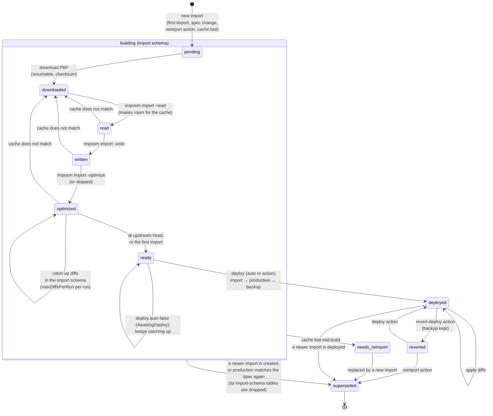
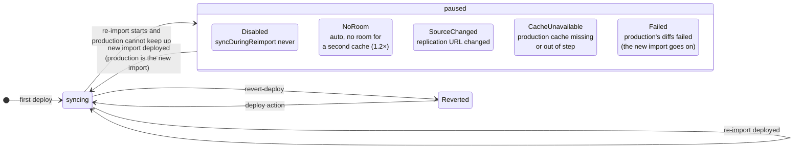
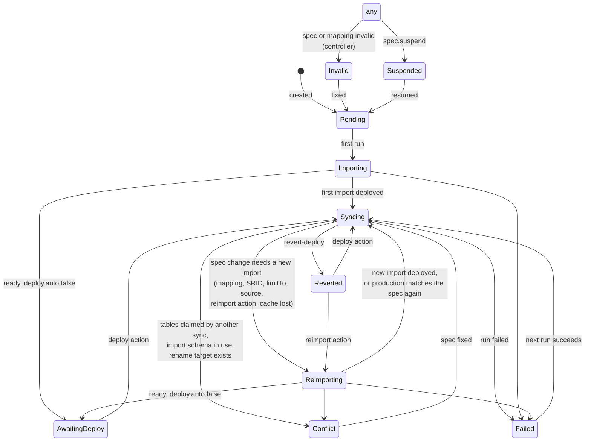
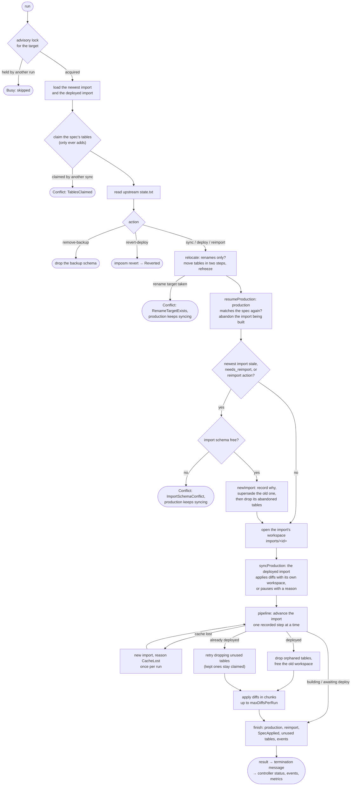

# State machines

Three state machines drive a sync:

- **Imports** are stored in the `imposm_operator.import` table, one row per snapshot import.
- **Production** is the deployed import. It either applies diffs or is paused.
- **The sync's phase** is `status.phase`. Each run's result sets it, and the controller adjusts it.

A run (`imposm-operator run`) is a bounded unit of work. It moves these machines forward and stops at the first error, so the next run resumes from the recorded state. The code is in `internal/engine` (`engine.go`, `tables.go`, `status.go`) and `internal/state`.

## Import lifecycle

The diagram below shows `state.ImportPhase`. Each step is recorded once it is done, so a run killed at any point resumes at the step it was on.

Notes:

- **Renames do not re-import.** When only the schema names, the table prefix or the table names change (`TablesHash` is unchanged), `relocate` moves the import's tables with `ALTER TABLE … SET SCHEMA / RENAME` and refreezes its configuration. The import keeps its phase. If a rename target already exists, the sync is in `Conflict` (`RenameTargetExists`).
- **A lost cache under a deployed import** (or a reverted one) leaves that import deployed and serving. The import's last error is set, and a new import starts with reason `CacheLost`.
- **The import schema must be free.** `checkImportSchemaFree` refuses to start an import into a schema that holds tables in use (for example the production schema). The sync is then in `Conflict` (`ImportSchemaConflict`), and production keeps syncing.
- **After a deploy**, the tables the new mapping no longer has are dropped (`dropOrphans`). Tables that something depends on are kept and listed in `status.unusedTables`.

## Production during a re-import

While a new import is built, the deployed import can keep applying diffs. It uses its own frozen configuration, mapping and cache in `imports/<id>/`. This depends on `deploy.syncDuringReimport`.

`status.production.syncing` and `pausedReason` report this state, together with the `ProductionSyncing` condition and the `imposm_sync_production_paused{reason}` metric. The `ReimportHeadroom` condition shows in advance whether an `auto` re-import would pause. When a pause starts and when it ends, the controller records `ProductionPaused` and `ProductionResumed` events.

## Sync phase (`status.phase`)

- **`Ready` is true while production serves current data:** in `Syncing`, `Reimporting` and `AwaitingDeploy`, as long as production is not paused and the last run succeeded.
- **`SpecApplied`** says whether production already runs the current spec. When it does not, the reason is one of `Importing`, `Reimporting`, `Pending`, `Reverted`, `TablesClaimed`, `ImportSchemaConflict` or `RenameTargetExists`.
- **The controller sets `Invalid`, `Suspended` and `Pending` itself.** All other phases come from the result of the newest finished run. A run killed before it reported anything counts as failed (the `RunKilled` event).

## One run

